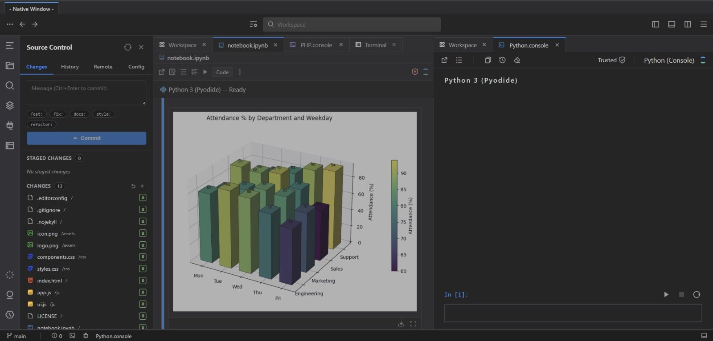
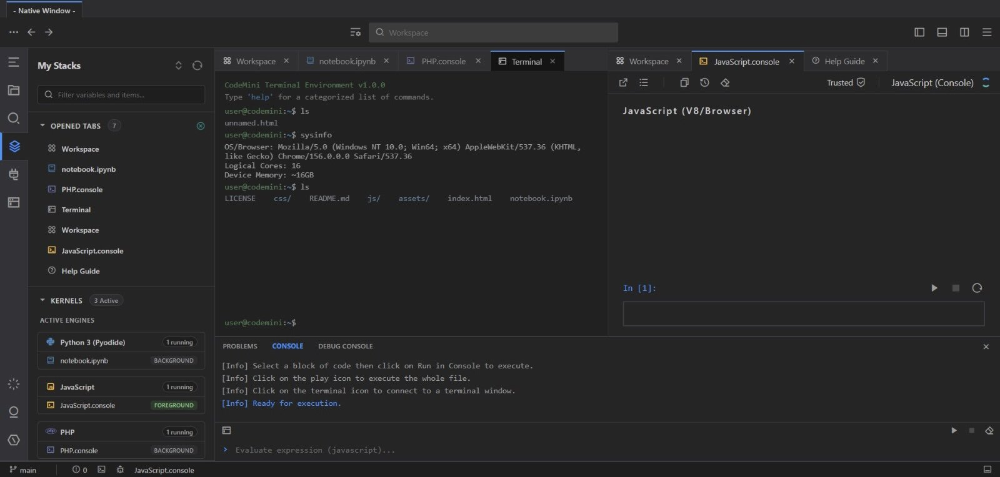
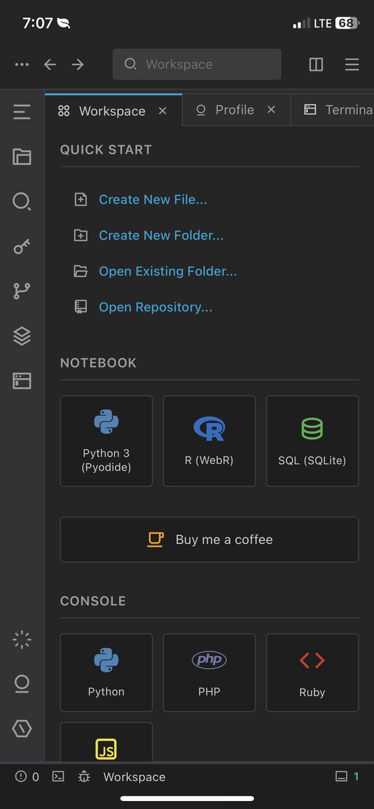
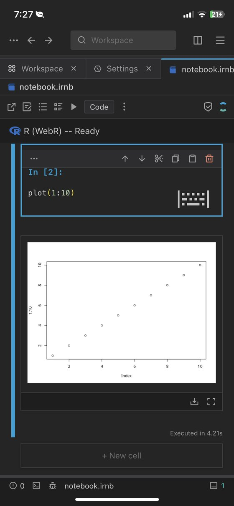

<div align="center">


# CodeMini IDE

**An offline-first, installable IDE that runs entirely in your browser.**
No backend. No account. No build step.

[](https://codemini-ide.vercel.app/)
[](CHANGELOG.md)
[](LICENSE)
[](https://codemini-ide.vercel.app/)

**[Try it live](https://codemini-ide.vercel.app/)** · [Changelog](CHANGELOG.md) · [Security](SECURITY.md) · [Privacy](PRIVACY.md) · [Contributing](CONTRIBUTING.md)

<br>



</div>

## What is CodeMini?

CodeMini is a full coding workspace that lives in a browser tab, or on your home screen once installed. Write code, run notebooks in Python, R and SQL, preview web pages, work in a terminal and push to GitHub, all without a server. Your files stay on your device, and once the app's assets are cached it keeps working with no connection.

It is built to be usable on a phone as well as a laptop.

## Highlights

| | |
| --- | --- |
| **Editor** | Monaco with Emmet, multiple windows and profiles, each with isolated storage and UI state |
| **Notebooks** | In-browser kernels for Python (Pyodide), R (WebR), SQL (SQLite) and Ruby, with plot and table output |
| **Consoles** | JavaScript, Python, PHP and Ruby consoles, plus an integrated terminal with shell-style commands |
| **Git and GitHub** | Clone/import, commit, pull and push with your own token, called straight from the browser. The terminal has a `git` command that works on the same repository |
| **Viewers** | PDF, Word documents, images, audio, video and archives open in tabs |
| **Safe by default** | Code you run executes on a separate origin and cannot read your files, token or keys |
| **Private** | My Keys, an AES-256-GCM encrypted vault for API keys and passwords, never uploaded |
| **Installable** | PWA with offline support, app shortcuts and an in-app update notice |

## Screenshots

<div align="center">



<sub>Split panes: terminal and JavaScript console side by side, with Stacks showing open tabs and which kernels are running.</sub>

<br><br>


&nbsp;&nbsp;&nbsp;&nbsp;


<sub>On a phone: the Workspace start page, and R (WebR) plotting in a notebook cell.</sub>

</div>

## Features

### Write and run code

- **Code editor** powered by Monaco, with Emmet support
- **Notebooks** with in-browser kernels for Python (Pyodide), R (WebR), SQL (sql.js) and Ruby
- **Consoles** for JavaScript, Python, PHP and Ruby, and an **integrated terminal** with a set of shell-style commands, including **`git`** (status, add, commit, log, diff, show, branch, switch/checkout, restore, reset, merge, stash, tag, reflog; run `git help`). It shares commits, branches, stashes and staging with the Source Control panel. Push, pull, fetch, clone, rebase, cherry-pick and revert stay in the panel
- **PHP and web previews** that run in the browser, with Console, Network and Inspector panels

### Manage your work

- **Multiple windows and profiles**, each with its own isolated file storage and UI state
- **Git and GitHub integration** (clone/import, pull, push) using your own token. Push works like `git push`: your commits arrive as real commits and the branch moves once
- **Built-in viewers** for PDF, Word documents, images, audio, video and archives
- **Themes**, light and dark

### Stay safe and private

- **Isolated code execution.** Previews and the code you run (Console, Terminal, editor Run and Debug, Python/R/SQL notebooks) run on a separate origin, so they cannot read your files, GitHub token or My Keys vault ([details](#isolated-code-execution))
- **Workspace Trust** with a Restricted Mode, configurable in Settings > Security
- **My Keys**, an encrypted, password-protected vault for API keys, tokens and passwords (AES-256-GCM, never uploaded, locks itself)

### Install it like an app

- **Installable PWA** with offline support, an in-app **Install App** menu item (Chromium) and app shortcuts (New File, Terminal, Search, Settings)
- **Update notices.** A new version never reloads the page by itself, so unsaved edits are safe. Settings > Updates shows the status and a **Check for updates** button
- **Notifications** in the Now Island, including app updates

## Quick start

### Use it online

1. Open **[codemini-ide.vercel.app](https://codemini-ide.vercel.app/)** in Chrome, Edge or Safari.
2. Optionally install it with the browser's install option to add it as an app.
3. Pick a notebook or console from the Workspace start page, or create a file.

### Run it locally

CodeMini is static files, but it must be served over HTTP(S), because a service worker does not run from `file://`.

```bash
git clone https://github.com/codercriss/CodeMini-IDE.git
cd CodeMini-IDE
npm start          # serves on http://localhost:3000
```

Any static server works, for example `python3 -m http.server 3000`. `localhost` counts as a secure context, so the service worker and install prompt work in development.

## Isolated code execution

By default (Settings > Security > Isolation Mode: **Isolated**), code you run does not run inside CodeMini's own page. It runs on a second, separate site, the **runner** (`runner/`, its own static deployment). The browser's same-origin rules then keep that code away from CodeMini's storage, device key and functions.

| What | Runs on the runner as | Setting |
| --- | --- | --- |
| Live Preview | a `blob:` page the runner mints | Live Preview |
| Console (JavaScript, Python, PHP, Ruby), the editor's Run button, the bottom Console's input field, the editor's Debug | a hidden per-window host (`runner/exec.html`) | Console |
| Terminal `js`, `python -c`, `php -r`, `ruby -e`, script files | the same host | Terminal |
| Python, R and SQL notebook cells and their scratchpads | the same host | Notebooks |

Each surface follows the global mode unless you override it (Use global, Isolated, Same origin). If the runner cannot be reached, the code falls back to running inside the app, with a note, and the shield icon turns amber.

<details>
<summary><strong>Deploying and versioning the runner</strong></summary>

<br>

- **The runner is a separate deployment with its own repository, `CodeMini-Runner`** (Vercel deploys it from there). `runner/` in this repository is a copy, kept so the tests and the hand-over zip are self-contained. The tests read it, so it must be kept in step.
- **Order matters.** Change the runner in `CodeMini-Runner` first, copy the files here, and deploy the runner before the app.
- **The runner has a version.** Both runner pages report it when the app connects (`runner/config.js`). The app will not run code on a runner older than it needs. It runs the code inside the app instead and says so once, with the reason ("the runner is out of date ... Redeploy the runner project").
- **Settings > Security > Check runner** shows which version is actually deployed, without running anything.

More detail is in [`runner/README.md`](runner/README.md) and [`SECURITY.md`](SECURITY.md).

</details>

> **Known limit:** a loop that never gives control back (`while True: pass`, `while (true) {}`) freezes the whole app until it ends, and Stop cannot interrupt it (measured on an iPhone; R is not affected because it runs in its own Worker). Running Python and JavaScript in Workers is planned.

## Privacy

Everything runs client-side. Files, settings and tokens stay in your browser storage. Runtime libraries are fetched from public CDNs (listed in [THIRD_PARTY_NOTICES.md](THIRD_PARTY_NOTICES.md)) and cached for offline use. See [PRIVACY.md](PRIVACY.md) for details.

## Development

New here? Start with [CONTRIBUTING.md](CONTRIBUTING.md). There is no build step and no dependencies to install: edit a file, refresh the page.

### Project structure

```
.
├── index.html              App shell and script load order
├── sw.js                   Service worker (must stay at the site root)
├── manifest.json           PWA manifest
├── vercel.json             Hosting headers (keeps sw.js uncached)
├── icons/                  App icons: icon.png (512), icon-192, icon-maskable-192/512, apple-touch-icon, favicons
├── docs/images/            Screenshots used in this README (repository only, not deployed: listed in .vercelignore)
├── runner/                 The preview/execution runner (copy of CodeMini-Runner)
├── PRIVACY.md, SECURITY.md, LICENSE, THIRD_PARTY_NOTICES.md
├── css/
│   ├── style.css           Layout and components
│   └── themes.css          Theme variables
├── js/
│   ├── core/               App bootstrap (incl. ?action= shortcuts), app-info (version/links), shield (shared crypto, no UI),
│   │                       my-keys (My Keys vault), file-lock (locked files and folders), pwa (service worker registration,
│   │                       install, update state), now-island (notifications and their toast), app-alerts (storage and
│   │                       offline notices), editor, settings, search, uploads, workspace trust
│   ├── notebook/           Notebook UI, kernels, plot/table preview
│   ├── viewers/            PDF, Word, media, archive and web preview tabs
│   ├── terminal/           Terminal window, commands, console panel
│   └── git/                Git/GitHub integration and stacks
├── tools/
│   └── capture-screenshots.js  Captures the install-dialog screenshots into screenshots/ and manifest.json
└── tests/                  Unit tests (Node only) and e2e/ (Playwright)
```

### Adding or moving a file

Scripts are plain `<script>` tags, so **load order in `index.html` matters**. When you add, rename or move an asset:

1. Update the tag in `index.html`.
2. Update `STATIC_ASSETS` in `sw.js`.
3. Bump `CACHE_NAME` in `sw.js` so installed copies refresh. This means bumping `version` in `package.json` and `js/core/app-info.js` too; `npm test` checks they match.

CI fails if a precached path does not exist.

### Tests

```bash
npm test                      # fast unit tests (Node only)

npm install                   # one time: installs Playwright
npx playwright install chromium
npm run test:e2e              # all end-to-end suites
npm run test:e2e -- preloader # only suites whose file name contains "preloader"
```

The suite name is a substring: `runner` matches both `runner.e2e.js` and `runner-exec.e2e.js`; use `runner.e2e` or `runner-exec` to pick one. The e2e runner serves the repo on `http://localhost:8765` itself, so nothing else needs to be running. Suites block third-party CDNs and stub Monaco, so they run offline and fast.

<details>
<summary><strong>Unit tests</strong> (<code>tests/*.test.js</code>)</summary>

<br>

| Test | Covers |
| --- | --- |
| `policy.test.js` | Workspace Trust policy (no browser needed) |
| `shield.test.js` | Shield crypto layer and device key, plus opening records made by the pre-Shield code (`tests/fixtures/`) |
| `exec.test.js` | The runner's code-execution host (JavaScript for real) and the Console/Terminal wiring |
| `runner.test.js` | Preview runner: the shell and client against fake windows (allowlist, handshake, relay, spoofing, fallback) |
| `runner-version.test.js` | The runner's version handshake: the app never needs more than the runner has, a bump is written down, both pages send the version, hostile values are cut down |
| `exec-sinks.test.js` | Ratchet on every line in `js/` that can run code (a new one fails until reviewed), plus checks that Settings, My Keys and `SECURITY.md` describe isolation truthfully |
| `html-sinks.test.js` | Shared escaper, the HTML-sink scanner and its per-file ratchet (new unescaped interpolations fail CI) |
| `hardening.test.js` | Referrer policy, third-party script rules, noopener, CI permissions, the SRI tool (offline) |
| `git-token.test.js` | Where the GitHub token lives: device-key encryption, migrations, fallbacks, lost key, reloads |
| `git-push.test.js` | Push as one real push: plan, commit messages and order, deletions, binary files, empty repositories, failures leaving GitHub untouched, the unpushed count, against a strict fake GitHub |
| `my-keys.test.js` | My Keys record format, password rules, validation and wiring checks |
| `file-lock.test.js` | Locked files and folders: locks, encrypted text, legacy upgrade, wiring checks |
| `paths.test.js` | The helper every test uses to find the runner and report a missing hidden file plainly |
| `app-info.test.js` | Keeps version, links and About page consistent with the repo |
| `release-history.test.js` | Keeps the in-app version history in step with `CHANGELOG.md` and the app version |
| `bin-restore-confirm.test.js` | Stacks > Recycle Bin: Restore and Restore All ask first |
| `terminal-git.test.js` | The terminal's `git` command against the real `git.js` and an in-memory database: every subcommand, the repository shared with the panel, no silent loss (switch, reset, merge, stash), conflicts, workspace roots, escaped output |
| `pwa.test.js` | Manifest, icons, shortcuts, screenshots, `<head>` links and precache list agree |
| `update-state.test.js` | Update flow in `pwa.js`: shared state, toast, manual vs scheduled checks |
| `sw.test.js` | Service worker strategy: network-first, timeout, offline fallback |

</details>

<details>
<summary><strong>End-to-end suites</strong> (<code>tests/e2e/*.e2e.js</code>)</summary>

<br>

| Suite | Covers |
| --- | --- |
| `workspace-trust.e2e.js` | Trust prompt, Restricted Mode, banner, settings and persistence |
| `terminal-trust.e2e.js` | Terminal refuses to run files in a restricted workspace |
| `terminal-git.e2e.js` | `git` typed into the real terminal: quoting, pipes, folders, branch switching with the Explorer and status bar, a merge conflict, stash, history after a reload |
| `regressions-1-3-2.e2e.js` | The 1.3.2 fixes: shared dialog text, Console Trusted toggle, Variables Explorer Refresh, SQL copy table, archive Extract all, date labels |
| `theme-flash.e2e.js` | Saved theme, accent and opacity applied from the first frame (no flash) |
| `preloader.e2e.js` | Startup overlay timing, minimum/maximum display, fade-out |
| `profile-overlay.e2e.js` | Profile/window switch overlay behavior |
| `explorer.e2e.js` | Explorer toolbar, search box and New Folder flow |
| `preview-panels.e2e.js` | Live Preview Console/Network/Inspector panels: layout, push behavior, one-at-a-time |
| `notifications.e2e.js` | Now Island notifications and the update flow: toast, notification, Settings > Updates |
| `keys-vault.e2e.js` | My Keys: password setup, locking/unlocking, add/edit/delete, auto-lock, backup, erase |
| `runner-exec.e2e.js` | The execution host: Console, Terminal, editor Run/Debug and Python/R/SQL notebooks. Isolation proofs, hostile output, settings, Stop/Interrupt, fallback, teardown, older runner |
| `runner.e2e.js` | Isolated previews on two real origins: page works, cannot reach the app, forged messages ignored, fallback, Settings > Security, status bar icon |
| `xss-names.e2e.js` | Hostile file, folder and archive-entry names across the UI: shown as text, nothing runs |
| `sanitize.e2e.js` | `CodeMiniEscape.sanitize`: 30 hostile payloads, stability on re-sanitizing, ordinary Markdown surviving |
| `git-token.e2e.js` | GitHub token encrypted with the device key, usable with My Keys locked and after a reload, disconnect, lost key, migration |
| `launch-actions.e2e.js` | App shortcuts: `/?action=new-file`, `terminal`, `search`, `settings` |

`theme-premium-compare.manual.js` is a manual before/after comparison tool and is not part of the automated run.

</details>

### App icons

The icon set in `icons/` is generated from one 940x940 master image. When you change the logo, regenerate all of these (sizes matter; `npm test` verifies real PNG headers and dimensions):

| File | Size | Used for |
| --- | --- | --- |
| `icon.png` | 512x512 | Manifest ("any"), Settings > About |
| `icon-192.png` | 192x192 | Manifest ("any") |
| `icon-maskable-192.png`, `icon-maskable-512.png` | 192 / 512 | Manifest ("maskable"): full-bleed background, logo kept inside the central 80% safe zone so Android's circle/squircle masks never clip it |
| `apple-touch-icon.png` | 180x180 | iOS home screen |
| `favicon.ico`, `favicon-32.png`, `favicon-16.png` | 16-48 | Browser tabs. Logo only on a transparent background so it stays readable at tiny sizes |

### App shortcuts

Installed copies get shortcuts (long-press the icon on Android, right-click it on Windows/Linux/ChromeOS, the dock menu on macOS). They are the `shortcuts` in `manifest.json` and open the app at `/?action=<name>`. `js/core/app.js` (`LAUNCH_ACTIONS`) performs the action once the app has finished starting, then removes it from the address bar.

To add one, add the handler, add the manifest entry, and keep the total to four (Android shows no more). `npm test` checks the two lists agree. The shortcuts have no icons of their own, so platforms show the app icon.

### Updates

When a new version is deployed, an installed or open copy notices it in the background. It re-checks hourly and whenever the app is shown again (both skipped if **Settings > Updates > Auto Check Updates** is off), and **Check for updates** always works. A new version never reloads the page by itself, so unsaved edits are safe. Instead:

- a toast says "CodeMini IDE was updated" with a **Reload** button,
- Settings > Updates shows "Update installed" with **Reload now**,
- Now Island > Notifications gets an "Update installed" notification, which reads "Update applied" after the next reload.

`js/core/pwa.js` owns the state (`CodeMiniPWA.getUpdateState()` and the `codemini:update-state` event); the three places above only display it. To ship an update the service worker file has to change, so bump the version as described in [Adding or moving a file](#adding-or-moving-a-file).

### Install-dialog screenshots

Chrome shows a richer install dialog when the manifest lists screenshots. They must be real captures of the running app, so they are generated rather than hand-made:

```bash
npm install && npx playwright install chromium   # one time
npm run screenshots
```

This needs internet access (Monaco and the icon font come from CDNs; the script stops instead of saving a capture without them). It writes `screenshots/*.png` (wide 1280x720, narrow 780x1688) and rewrites the `screenshots` list in `manifest.json`. Look at the pictures before committing, and re-run it when the UI changes noticeably. `npm test` checks the declared files and Chrome's size rules.

> The pictures in this README live in `docs/images/` and are separate from the generated `screenshots/` folder, so `npm run screenshots` never overwrites them.

## Deploying

The reference deployment runs on Vercel at <https://codemini-ide.vercel.app/>. Any static host works. The repository includes a `vercel.json` that serves `sw.js` with `no-cache` so updates reach users promptly.

Serve the site from the **root of a domain**, or adapt the absolute `/sw.js`, `/icons/...`, `id`, `scope` and `start_url` paths in `index.html`, `js/core/pwa.js`, `sw.js` and `manifest.json`.

`runner/` and `docs/` are listed in `.vercelignore`, so neither is part of the app deployment (the README screenshots stay in the repository only).

Remember the order: deploy the **runner first, then the app** (see [Isolated code execution](#isolated-code-execution)).

## Contributing

Contributions are welcome. See [CONTRIBUTING.md](CONTRIBUTING.md). For security issues, see [SECURITY.md](SECURITY.md).

## Credits

Created and maintained by [Christian Forson](https://github.com/codercriss).

## License

[MIT](LICENSE). Third-party libraries keep their own licenses; see [THIRD_PARTY_NOTICES.md](THIRD_PARTY_NOTICES.md).
